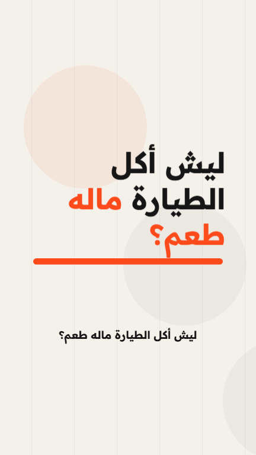
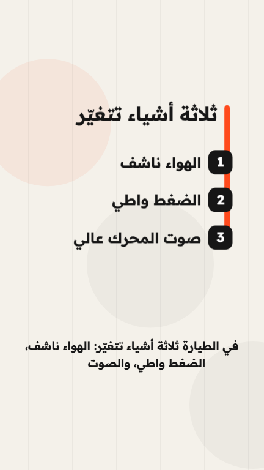
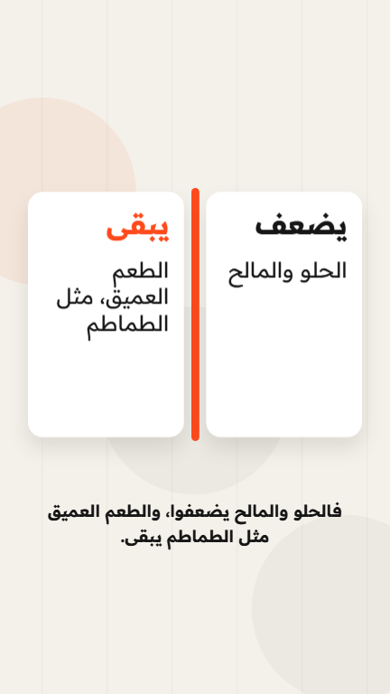
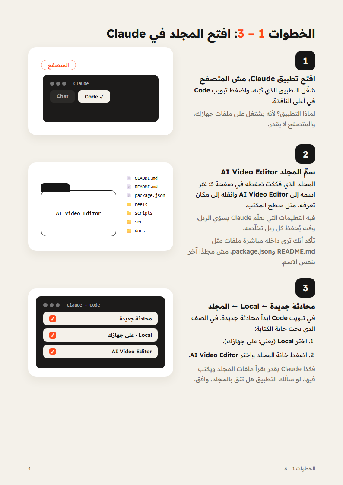
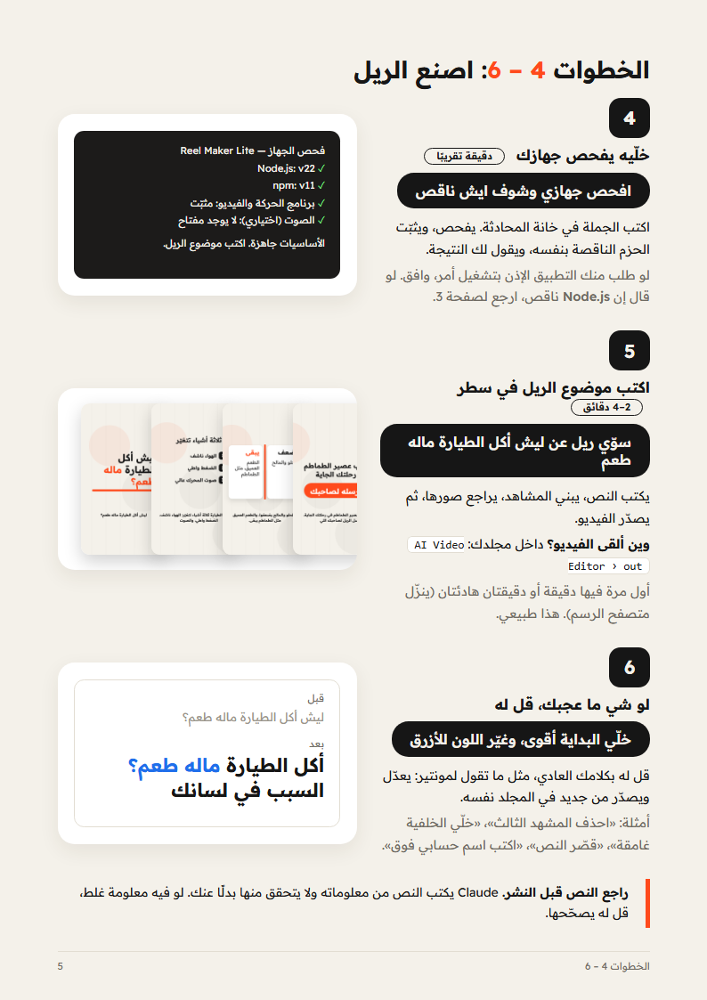
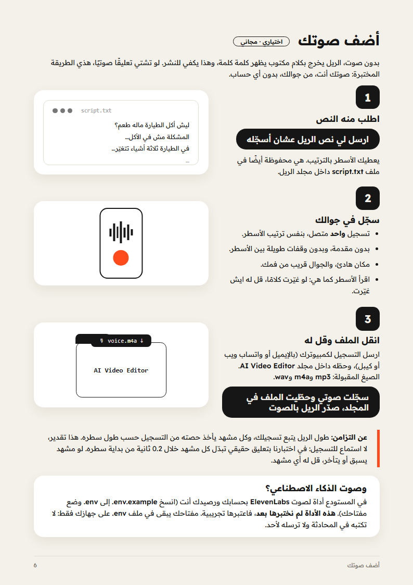

<div dir="rtl">

# GAOBA AI Reel Maker Lite

**أول ريل متحرك لك بـ Claude Code، في ست خطوات.**

نسخة مجانية ومبسّطة من طريقة GAOBA AI ‏([@a_gaoba.ai](https://www.instagram.com/a_gaoba.ai)): تفتح مجلدًا في Claude Code، تكتب موضوع الريل في سطر واحد، ويطلع لك فيديو MP4 عمودي (1080×1920) بنصوص متحركة.

<p align="center">
  
  
  
  
</p>

> **بصراحة:** السطر الواحد يكفي **بعد** تجهيز يتم مرة واحدة (تطبيق Claude باشتراك مدفوع، ‏Node.js، وتثبيت الحزم). وهذي نسخة Lite: ليست النظام الكامل الذي تُصنع به ريلز GAOBA AI. الفرق مكتوب تحت بالتفصيل.

- 📘 **الدليل المصوّر للمبتدئ (ابدأ منه):** [`docs/guide.pdf`](docs/guide.pdf)
- 🎬 **مثال صُدّر بهذه النسخة:** [`docs/example.mp4`](docs/example.mp4)
- 🧪 **ما اختبرناه وما لم نختبره:** [`docs/TEST-REPORT.md`](docs/TEST-REPORT.md)

## ايش تحتاج

| المطلوب | ملاحظة | التكلفة |
|---|---|---|
| كمبيوتر Windows أو Mac | اختُبرت هذه النسخة على Windows 11 فقط | — |
| [تطبيق Claude للكمبيوتر](https://claude.com/download) | Claude Code غير متاح في الخطة المجانية: يحتاج خطة Pro أو أعلى (حسب [صفحة الأسعار](https://claude.com/pricing) وقت الكتابة) | اشتراك شهري |
| [Node.js](https://nodejs.org) نسخة LTS | تنزّله أنت مرة واحدة | مجاني |
| إنترنت | لتثبيت الحزم، ولتنزيل متصفح صغير للرسم (حوالي 130 MB، مرة واحدة)، ولتحميل الخط عند كل تصدير | — |
| 2 GB مساحة فاضية | | — |

## التجهيز (مرة واحدة)

1. **نزّل Node.js:** افتح [nodejs.org](https://nodejs.org)، اضغط زر التنزيل المكتوب عليه **LTS**، افتح الملف واضغط Next حتى النهاية.
2. **نزّل تطبيق Claude للكمبيوتر** من [claude.com/download](https://claude.com/download) وسجّل الدخول. لو كان مفتوحًا قبل تثبيت Node.js، أغلقه وافتحه من جديد.
3. **نزّل هذه الملفات:** في أعلى هذه الصفحة اضغط الزر الأخضر **Code** ثم **Download ZIP**، وفكّ الضغط (في Windows: زر أيمن ثم Extract All).

## الخطوات الست



1. **افتح تطبيق Claude، مش المتصفح**، واضغط تبويب **Code**. التطبيق هو الذي يشتغل على ملفات جهازك.
2. **سمِّ المجلد `AI Video Editor`** وحطّه في مكان تعرفه. تأكد أنك ترى داخله مباشرة ملفات مثل `README.md` و`package.json`.
3. **محادثة جديدة ← Local ← المجلد.** في الصف الذي تحت خانة الكتابة اختر **Local** (يعني على جهازك)، ثم اختر مجلد `AI Video Editor`.



4. **اكتب له:** `افحص جهازي وشوف ايش ناقص`. يفحص، يثبّت الحزم الناقصة، ويقول لك النتيجة.
5. **اكتب موضوع الريل في سطر واحد**، مثل: `سوّي ريل عن ليش أكل الطيارة ماله طعم`. يكتب النص، يبني المشاهد، يراجع صورها، ويصدّر الفيديو. تلقاه داخل المجلد في `out`.
6. **لو شي ما عجبك، قل له** بكلامك العادي: `خلّي البداية أقوى، وغيّر اللون للأزرق`. يعدّل ويصدّر من جديد.

**كم يأخذ؟** على جهازنا: تثبيت الحزم أقل من دقيقة، أول رسم حوالي دقيقتين (ينزّل المتصفح)، والتصدير أقل من دقيقة. ريل كامل من سطر واحد أول مرة: حوالي 4 دقائق.

**راجع النص قبل النشر.** Claude يكتب النص من معلوماته ولا يتحقق منها بدلًا عنك.

## أضف صوتك (اختياري ومجاني)

بدون صوت يخرج الريل بكلام مكتوب يظهر كلمة كلمة. لو تشتي تعليقًا صوتيًا، هذي الطريقة المختبرة:



1. اكتب له: `ارسل لي نص الريل عشان أسجّله`. الأسطر محفوظة أيضًا في `reels/<اسم-الريل>/script.txt`.
2. سجّل في جوالك: تسجيل **واحد** متصل، بنفس الترتيب، بدون مقدمة ولا وقفات طويلة.
3. انقل الملف (mp3 أو m4a أو wav) إلى مجلد `AI Video Editor` واكتب له: `سجّلت صوتي وحطّيت الملف في المجلد، صدّر الريل بالصوت`.

**عن التزامن:** كل مشهد يأخذ حصته من تسجيلك حسب طول سطره. هذا تقدير، لا استماع للتسجيل: في اختبارنا بتعليق حقيقي تبدّل كل مشهد خلال 0.2 ثانية من بداية سطره.

**صوت بالذكاء الاصطناعي:** في المستودع أداة لـ ElevenLabs بحسابك ورصيدك أنت (انسخ `.env.example` إلى `.env` وضع مفتاحك). **هذه الأداة لم تُختبر بعد**، فاعتبرها تجريبية. مفتاحك يبقى في `.env` على جهازك فقط، والملف مستثنى من git.

## بصدق: ايش في Lite وايش في النظام الاحترافي

الريل الذي أوصلك لهذا المستودع صُنع بالنظام الاحترافي لـ GAOBA AI. نسخة Lite تمشي على الخطوات الست نفسها، لكنها أبسط:

| ما يقوله الريل | في نسخة Lite | في النظام الاحترافي فقط |
|---|---|---|
| الخطوات 1–4 والخطوة 6 | ✅ كما هي | — |
| «بيكتب النص» | ✅ 5–8 مشاهد | بحث ومصادر واختبار فهم |
| «ويسجّل الصوت» | 🟡 صوتك أنت (مختبر)، أو ElevenLabs بحسابك (غير مختبر) | صوت مستنسخ ومحاذاة لكل كلمة |
| «ويحرّك كل مشهد» | ✅ بستة قوالب جاهزة | مشاهد تُبنى لكل ريل، ثلاثية الأبعاد، وكاميرا |
| «ويضبط الكلام اللي على الشاشة مع كل كلمة» | 🟡 بالتقدير، لا بالاستماع للصوت | توقيت حقيقي من التسجيل |
| «ويفحص الحركة قبل ما تشوفها» | 🟡 يفحص صورة من كل مشهد | فحص للحركة والصوت وفيديو المعاينة |
| موسيقى ومؤثرات صوتية | ❌ | ✅ |
| صور ومقاطع | ❌ | ✅ |

## أنواع المشاهد الستة

| النوع | متى يُستخدم |
|---|---|
| `hook` | السطر الأول: السؤال أو المشكلة |
| `point` | فكرة واحدة، مع سطر صغير اختياري |
| `steps` | قائمة من 2 إلى 5 عناصر قصيرة |
| `number` | رقم واحد حقيقي وما يعنيه |
| `compare` | شيئان جنب بعض |
| `cta` | الدعوة في النهاية، مع كلمة على الزر |

كل الحقول في [`templates/reel.template.json`](templates/reel.template.json)، ومثال كامل في [`reels/example-airplane-food/reel.json`](reels/example-airplane-food/reel.json). لا تحتاج تكتب هذه الملفات بنفسك: Claude يكتبها.

## بنية المستودع

```
AI Video Editor/
├─ CLAUDE.md                                يوجّه Claude إلى التعليمات
├─ .claude/skills/reel-maker-lite/SKILL.md  التعليمات نفسها
├─ reels/example-airplane-food/reel.json    مثال جاهز
├─ templates/reel.template.json             كل الحقول المتاحة
├─ scripts/check.mjs                        فحص الجهاز
├─ scripts/render.mjs                       صور الفحص وتصدير الـMP4
├─ scripts/voice.mjs                        صوت ElevenLabs (اختياري، غير مختبر)
├─ src/                                     كود الرسم والحركة
├─ docs/                                    الدليل المصوّر، مثال MP4، تقرير الاختبار
└─ out/                                     هنا تطلع فيديوهاتك
```

## جرّبه بدون Claude (للمتمرّسين)

```bash
npm install
```

```bash
npm run check
```

```bash
npm run render -- example-airplane-food
```

الفيديو يطلع في `out/example-airplane-food.mp4`.

## لو وقفت

| المشكلة | الحل |
|---|---|
| «npm غير معروف» | Node.js غير مثبّت أو التطبيق لم يُعد تشغيله. ثبّته، أغلق تطبيق Claude وافتحه، ثم أعد الفحص |
| هادئ لدقيقة أو دقيقتين أول مرة | ينزّل متصفح الرسم (حوالي 130 MB). انتظر |
| الخط غريب أو الحروف مقطّعة | لا يوجد إنترنت وقت التصدير، فلم يُحمَّل الخط |
| Claude لا يعرف ايش تقصد | تأكد أنك اخترت Local والمجلد الصحيح، وابدأ محادثة جديدة |
| نص مقصوص أو صغير في مشهد | قل له: «النص في المشهد كذا طويل، قصّره» |

## الترخيص

كود هذا المستودع برخصة [MIT](LICENSE): استخدمه وعدّله بحرية.

المستودع يعتمد على [Remotion](https://remotion.dev) (يُثبَّت من npm وليس جزءًا من المستودع)، وله رخصته الخاصة: مجاني للأفراد والفرق الصغيرة، ورخصة مدفوعة للشركات الأكبر. اقرأ [remotion.dev/license](https://remotion.dev/license) قبل الاستخدام التجاري. خط Readex Pro يُحمَّل من Google Fonts برخصة SIL Open Font License. بقية الحزم (React وغيرها) برخص مفتوحة تُثبَّت من npm.

## من صنعه

GAOBA AI — [@a_gaoba.ai](https://www.instagram.com/a_gaoba.ai) على Instagram. لو صنعت ريلًا بهذه النسخة، أرسله لي.

</div>
